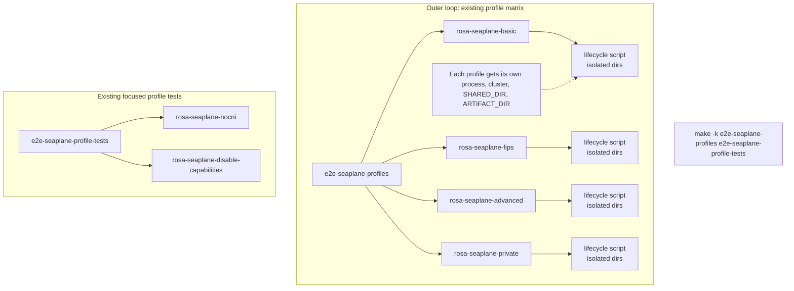

# Seaplane profile-aware E2E runbook

`TEST_PROFILE` is process-wide, not a Ginkgo label. Treat the profile as the
outer loop and the existing phase/label filters as the inner loop. The make
targets below launch one Ginkgo process per profile so the environment cannot
leak between profiles.

Run the commands below from the ROSA CLI repository root.

## Complete matrix

Run the shared lifecycle profiles and the focused profile-specific specs in one
local invocation:

```bash
SEAPLANE_URL=https://example.execute-api.us-east-1.amazonaws.com \
  OCP_IMAGE=quay.io/openshift-release-dev/ocp-release:5.0.0-rc.5-multi \
  GINKGO_BIN="$(go env GOPATH)/bin/ginkgo" \
  make -k e2e-seaplane-profiles e2e-seaplane-profile-tests
```

Install the Ginkgo CLI version selected by `go.mod` first with
`go install github.com/onsi/ginkgo/v2/ginkgo`; setting `GINKGO_BIN` this way
avoids a stale CLI version from `PATH`.

`e2e-seaplane-profiles` runs one lifecycle cluster per shared profile.
`e2e-seaplane-profile-tests` then runs the no-CNI and disabled-capabilities
specs, each with its dedicated profile. The `-k` flag makes Make continue to
the focused tests if a lifecycle profile fails; the overall command still
exits nonzero. Do not add `rosa-seaplane-nocni` or
`rosa-seaplane-disable-capabilities` to
`E2E_SEAPLANE_LIFECYCLE_PROFILES`: those specs create their own clusters and
must use the focused targets.

## Execution flow



Within one profile, a failed phase normally stops the remaining phases. Set
`E2E_SEAPLANE_CONTINUE_ON_FAILURE=true` to keep running later phases (for
example, `day2` after a `day1-post` failure). The cluster destroy still runs on
exit, and the profile still exits nonzero.

## Lifecycle profiles

Run the full lifecycle once per profile that can back the shared cluster:

```bash
SEAPLANE_URL=https://example.execute-api.us-east-1.amazonaws.com \
  make e2e-seaplane-profiles
```

The default profile order is `rosa-seaplane-basic`, `rosa-seaplane-fips`,
`rosa-seaplane-advanced`, and `rosa-seaplane-private`. Each profile gets its
own generated cluster name, `SHARED_DIR`, and `ARTIFACT_DIR` under
`tests/output/<profile>/`. Do not reuse one output directory between profiles:
`cluster-detail.json` and `resources.json` must describe the same cluster used
by later phases.

`rosa-seaplane-advanced` and `rosa-seaplane-private` use `version: latest` in
the profile file. Set a release image for those runs:

```bash
SEAPLANE_URL=https://example.execute-api.us-east-1.amazonaws.com \
  OCP_IMAGE=quay.io/openshift-release-dev/ocp-release:5.0.0-rc.5-multi \
  make e2e-seaplane-profiles
```

Override the profile list or output root when needed:

```bash
make e2e-seaplane-profiles \
  E2E_SEAPLANE_LIFECYCLE_PROFILES="rosa-seaplane-basic rosa-seaplane-fips" \
  E2E_SEAPLANE_OUTPUT_ROOT="$PWD/tests/output/my-run"
```

For a single profile, the existing target still applies:

```bash
SEAPLANE_URL=https://example.execute-api.us-east-1.amazonaws.com \
  TEST_PROFILE=rosa-seaplane-basic \
  make e2e-seaplane-day1-day2
```

## Profile-specific tests

Some tests require profiles that should not run the full lifecycle. Run those
as focused Day 1 jobs.

Run both focused tests:

```bash
SEAPLANE_URL=https://example.execute-api.us-east-1.amazonaws.com \
  make e2e-seaplane-profile-tests
```

Or run either test independently:

### No-CNI profile

```bash
SEAPLANE_URL=https://example.execute-api.us-east-1.amazonaws.com \
  make e2e-seaplane-nocni
```

### Disabled-capabilities profile

```bash
SEAPLANE_URL=https://example.execute-api.us-east-1.amazonaws.com \
  make e2e-seaplane-disable-capabilities
```

These two specs create and destroy their own temporary clusters, so they do not
need the `day1-readiness` or `day1-post` phases.

The targets generate a unique `CLUSTER_NAME` and keep each profile's artifacts
under `tests/output/<profile>/`.
